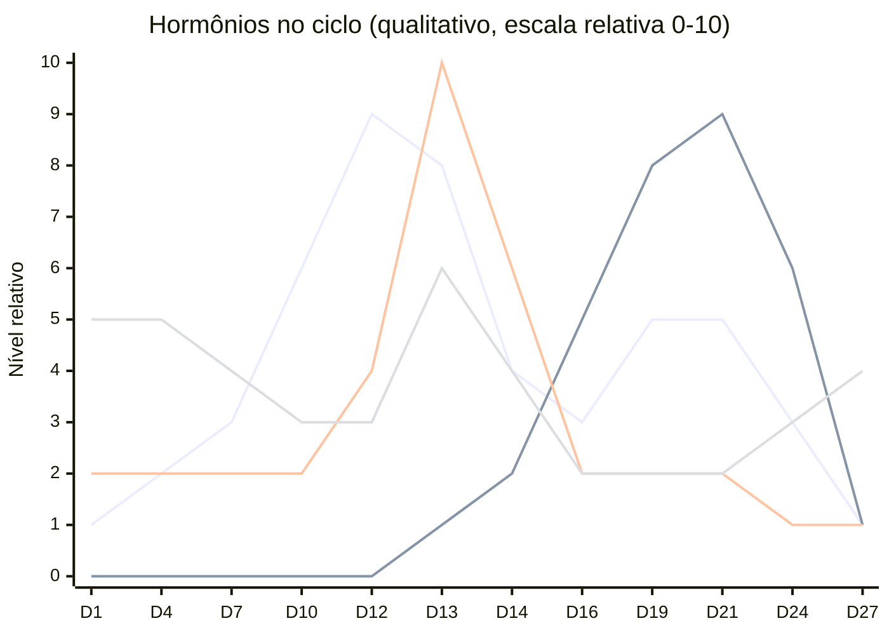

# 🌸 Estudo Completo: O Ciclo Menstrual — Ciência, Dados Reais e Implicações para o Charlee

> **Série de estudos:** **Ciclo menstrual** · [Alimentação alinhada ao ciclo](./alimentacao-ciclo-menstrual.md) · [Planejamento do trabalho e o ciclo](./planejamento-trabalho-ciclo.md)
>
> Pesquisa feita em 18/11/2026 a partir de literatura científica e dos dados do app de ciclo (capturas de tela de 18/11/2026).
>
> **⚠️ Aviso:** este documento é informativo e serve de apoio ao produto. Ele **não substitui avaliação médica/ginecológica**, não faz diagnóstico e não deve ser usado como método contraceptivo.

---

## Sumário

1. [Fisiologia: o que acontece em um ciclo](#1-fisiologia-o-que-acontece-em-um-ciclo)
   - 1.1 [Visão geral](#11-visão-geral)
   - 1.2 [O eixo hipotálamo–hipófise–ovário](#12-o-eixo-hipotálamohipófiseovário)
   - 1.3 [Os hormônios, um a um](#13-os-hormônios-um-a-um)
   - 1.4 [Curvas hormonais ao longo do ciclo](#14-curvas-hormonais-ao-longo-do-ciclo)
   - 1.5 [O ovário: foliculogênese, ovulação e corpo lúteo](#15-o-ovário-foliculogênese-ovulação-e-corpo-lúteo)
   - 1.6 [O útero: endométrio menstrual, proliferativo e secretor](#16-o-útero-endométrio-menstrual-proliferativo-e-secretor)
   - 1.7 [Muco cervical (secreção vaginal) por fase](#17-muco-cervical-secreção-vaginal-por-fase)
   - 1.8 [Temperatura basal e frequência cardíaca](#18-temperatura-basal-e-frequência-cardíaca)
   - 1.9 [Janela fértil](#19-janela-fértil)
2. [O que é "normal" (critérios FIGO)](#2-o-que-é-normal-critérios-figo)
3. [O que os dados de larga escala mostram](#3-o-que-os-dados-de-larga-escala-mostram)
4. [Como identificar a fase: métodos, precisão e limites](#4-como-identificar-a-fase-métodos-precisão-e-limites)
5. [O ciclo ao longo da vida e o que o altera](#5-o-ciclo-ao-longo-da-vida-e-o-que-o-altera)
6. [Mitos vs. evidências: energia, cognição, exercício, sono, humor](#6-mitos-vs-evidências)
7. [Condições de saúde e sinais de alerta](#7-condições-de-saúde-e-sinais-de-alerta)
8. [Análise dos seus dados (abr–nov/2026)](#8-análise-dos-seus-dados-abrnov2026)
9. [Como registrar bem](#9-como-registrar-bem)
10. [Implicações para o Charlee (Cycle-Aware)](#10-implicações-para-o-charlee-cycle-aware)
11. [FAQ — mitos e dúvidas comuns](#11-faq--mitos-e-dúvidas-comuns)
12. [Glossário](#12-glossário)
13. [Fontes](#13-fontes)

---

## 1. Fisiologia: o que acontece em um ciclo

### 1.1 Visão geral

O ciclo é contado do **1º dia da menstruação (D1)** — primeiro dia de sangramento real, não de escape/borra — até o dia anterior à menstruação seguinte. Ele acontece em dois "relógios" sincronizados:

- o **ciclo ovariano** (o que acontece no ovário: amadurecimento do folículo → ovulação → corpo lúteo);
- o **ciclo uterino/endometrial** (o que acontece no revestimento do útero: descamação → crescimento → preparação).

Ambos são comandados pelo **eixo hipotálamo → hipófise → ovário (HHO)**.

| Fase | Dias típicos (ciclo ~28d) | Ovário | Útero | Hormônios dominantes |
|---|---|---|---|---|
| **Menstrual** | D1–D5 | Início do recrutamento de folículos | Descamação do endométrio | Estrogênio e progesterona **baixos**; FSH começa a subir |
| **Folicular** (inclui a menstrual) | D1 → ovulação | Um folículo dominante amadurece | Fase **proliferativa**: endométrio engrossa | **Estradiol subindo** progressivamente |
| **Ovulação** | ~24–36h após o início do pico de LH | O folículo libera o óvulo (vive ~12–24h) | — | **Pico de LH** (disparado por estradiol alto); pequena alta de testosterona |
| **Lútea** | Ovulação → próxima menstruação | Corpo lúteo produz hormônios | Fase **secretora**: endométrio se prepara | **Progesterona alta** + estradiol moderado; sem gravidez, ambos caem → menstruação |

> **Atenção aos nomes:** muitos apps (e o próprio Charlee) falam em 4 fases — menstrual, folicular, ovulatória e lútea. Fisiologicamente, existem **duas fases ovarianas** (folicular e lútea) separadas por um **evento** (ovulação). A menstruação é o começo da fase folicular. Usar 4 "fases" é útil para comunicação, desde que fique claro que a "fase ovulatória" é uma janela curta e estimada.

### 1.2 O eixo hipotálamo–hipófise–ovário

```
        ┌─────────────────────┐
        │     HIPOTÁLAMO      │  libera GnRH em pulsos
        └─────────┬───────────┘
                  │ GnRH
                  ▼
        ┌─────────────────────┐
        │  HIPÓFISE ANTERIOR  │  libera FSH e LH
        └─────────┬───────────┘
          FSH     │     LH
                  ▼
        ┌─────────────────────┐
        │       OVÁRIO        │  produz estradiol, progesterona, inibina
        └─────────┬───────────┘
                  │ estradiol / progesterona
                  ▼
        ┌─────────────────────┐
        │  ÚTERO (endométrio) │  cresce, se prepara ou descama
        └─────────────────────┘

  Retroalimentação (feedback):
  • Estradiol moderado + progesterona → NEGATIVO (freiam FSH/LH)
  • Estradiol ALTO e sustentado (~fim da fase folicular) → POSITIVO (dispara o pico de LH)
  • Inibina B (folicular) / Inibina A (lútea) → freiam o FSH
```

Pontos-chave:
- O **GnRH** é liberado em **pulsos**; a frequência dos pulsos muda ao longo do ciclo e favorece mais FSH ou mais LH.
- Esse eixo é **sensível a estresse, sono, déficit de energia, doença e peso** — por isso esses fatores alteram o ciclo (ver seção 5).
- A virada de **feedback negativo → positivo** do estradiol é o que torna a ovulação possível: quando o folículo dominante produz estradiol alto o bastante por tempo suficiente, a hipófise responde com o **pico de LH**.

### 1.3 Os hormônios, um a um

| Hormônio | Produzido por | Papel principal | Quando está alto |
|---|---|---|---|
| **GnRH** | Hipotálamo | Comanda a hipófise a liberar FSH e LH | Pulsátil o ciclo todo |
| **FSH** (hormônio folículo-estimulante) | Hipófise | Recruta e faz crescer os folículos | Começo da fase folicular; pequeno pico junto com o LH |
| **LH** (hormônio luteinizante) | Hipófise | Dispara a ovulação; mantém o corpo lúteo | **Pico** curto (~1–2 dias) no meio do ciclo |
| **Estradiol** (principal estrogênio) | Folículo em crescimento; depois o corpo lúteo | Engrossa o endométrio; muco fértil; dispara o pico de LH | Pico **antes** da ovulação; segundo pico menor no meio da fase lútea |
| **Progesterona** | Corpo lúteo | Transforma o endométrio (secretor); eleva a temperatura; engrossa o muco | **Fase lútea**, pico ~7 dias após a ovulação |
| **Inibina** | Folículos / corpo lúteo | Freia o FSH | B na folicular; A na lútea |
| **Testosterona** (pequenas quantidades) | Ovário e adrenais | Libido, entre outros | Leve alta perto da ovulação |

### 1.4 Curvas hormonais ao longo do ciclo

Representação **qualitativa** (não em escala) de um ciclo de ~28 dias:

```
Nível
 ▲
 │                    LH
 │                    ║
 │                    ║
 │                   ║║
 │              E2  ▄║║                        
 │             ▄▄██▀ ║║        P4 ▄▄▄▄▄▄
 │          ▄▄█▀     ║║      ▄▄██▀▀▀▀▀▀██▄▄
 │ FSH▄▄  ▄█▀        ║▀▄  ▄▄█▀  E2 ▄▄▄▄▄   ▀█▄
 │ ▀▀▀▀▀▀▀▀▀▀▀▀▀▀▀▀▀▀▀▀▀▀▀▀▀▀▀▀▀▀▀▀▀▀▀▀▀▀▀▀▀▀▀▀▀▀▀▀▀▀
 └──┬──────┬──────┬──────┬──────┬──────┬──────┬───► Dia
    1      5      10     14     18     22     28
    │menstr│  folicular  │ovul.│        lútea       │

 E2 = estradiol · P4 = progesterona · LH = pico curto no meio · FSH alto no início
```

Versão em Mermaid (para visualizadores que suportam):



**Tabela qualitativa por fase:**

| Fase | FSH | LH | Estradiol | Progesterona | O que você pode sentir/observar |
|---|---|---|---|---|---|
| Menstrual (D1–D5) | ↑ subindo | baixo | ↓ baixo | ↓ baixo | Sangramento; cólica (prostaglandinas); cansaço em algumas pessoas |
| Folicular tardia (D6 → pré-ovulação) | ↓ caindo | baixo | ↑↑ subindo forte | baixo | Muco ficando mais úmido; muitas relatam mais disposição |
| Ovulação | pico pequeno | **pico grande** | pico → cai | começa a subir | Muco "clara de ovo"; às vezes dor no meio do ciclo (*mittelschmerz*); libido ↑ |
| Lútea inicial/média | baixo | baixo | moderado (2º pico) | **↑↑ alto** | Temperatura e FC de repouso ↑; muco espesso ou ausente |
| Lútea tardia (pré-menstrual) | começa a subir | baixo | ↓ caindo | ↓ caindo | Sintomas pré-menstruais (em quem tem): inchaço, seios sensíveis, irritabilidade |

### 1.5 O ovário: foliculogênese, ovulação e corpo lúteo

1. **Recrutamento (fim do ciclo anterior / início do atual):** a queda de progesterona e estradiol no fim da fase lútea deixa o FSH subir. Um grupo (*coorte*) de folículos antrais começa a crescer.
2. **Seleção do dominante (~D5–D7):** um folículo é mais sensível ao FSH e passa a produzir mais estradiol e inibina B. O FSH cai e os outros folículos regridem (*atresia*). O dominante segue crescendo até ~18–25 mm.
3. **Ovulação:** estradiol alto e sustentado → **pico de LH** → o folículo se rompe e libera o óvulo. O óvulo sobrevive ~12–24h.
4. **Corpo lúteo:** o que sobra do folículo vira o **corpo lúteo**, que produz progesterona (e estradiol). Ele vive **~12–14 dias** (na média populacional, 12,4 dias — ver seção 3). Sem gravidez, ele regride, os hormônios caem e o endométrio descama → nova menstruação.
5. **Se houver gravidez:** o hCG do embrião mantém o corpo lúteo, e a menstruação não vem.

> Por isso **a fase lútea é relativamente estável** e **a fase folicular é a que varia**: ciclos mais longos ou mais curtos refletem principalmente quanto tempo o folículo levou para ser selecionado e amadurecer.

**Ciclos anovulatórios:** às vezes não há ovulação (estresse, perimenopausa, adolescência, SOP, amamentação). Pode haver sangramento mesmo assim, mas **sem fase lútea real** — o app não "sabe" disso se usar só calendário.

### 1.6 O útero: endométrio menstrual, proliferativo e secretor

| Fase uterina | Coincide com | O que acontece |
|---|---|---|
| **Menstrual** | Início da folicular | Queda de progesterona → vasoconstrição e **prostaglandinas** → descamação da camada funcional. As prostaglandinas também contraem o útero (cólica) e podem afetar o intestino (diarreia, náusea). |
| **Proliferativa** | Folicular | O estradiol faz o endométrio se regenerar e engrossar; glândulas e vasos crescem. |
| **Secretora** | Lútea | A progesterona transforma o endométrio: glândulas secretam nutrientes, o tecido fica "receptivo" para implantação. |

### 1.7 Muco cervical (secreção vaginal) por fase

O muco do colo do útero muda com os hormônios — e o app que você usa já tem as categorias certas para acompanhar isso.

| Momento do ciclo | Hormônio dominante | Aparência típica | Categoria no seu app |
|---|---|---|---|
| Logo após a menstruação | Estradiol baixo | Pouca ou nenhuma secreção, sensação "seca" | **Sem secreção** |
| Início da subida do estradiol | Estradiol ↑ | Opaca, grudenta, esbranquiçada | **Pastosa** / **Viscosa** |
| Perto da ovulação | Estradiol alto | Cremosa → **úmida, transparente** | **Aquosa** |
| Pico fértil (≈ dia do pico de LH) | Estradiol no pico | **Transparente, elástica, escorregadia**, estica entre os dedos | **Clara de ovo** |
| Após a ovulação | Progesterona ↑ | Espessa, pegajosa ou ausente | **Pastosa** / **Sem secreção** |

Evidência: o "dia pico" do muco tende a coincidir com o **dia do pico de LH** (ou o dia anterior), e em estudos acertou a ovulação com ±1 dia em ~78% dos ciclos e ±2 dias em ~91%. Mais de 97% dos dias-pico caíram até ±4 dias da ovulação estimada.

**Categorias de alerta no app** (não fazem parte do padrão fisiológico): **Branca grumosa** (pode sugerir candidíase), **Cinza** (pode sugerir vaginose bacteriana, especialmente com odor), **Corrimento incomum** e **Sangramento de escape**. Se repetirem ou vierem com coceira, odor, dor ou ardor → avaliação médica.

### 1.8 Temperatura basal e frequência cardíaca

- Após a ovulação, a **progesterona eleva a temperatura basal** (ao acordar, em repouso) em geral **~0,2–0,5 °C**, sustentada até a próxima menstruação. A subida aparece 1–3 dias **depois** da ovulação → a temperatura **confirma retroativamente**, não prevê.
- Alguns ciclos ovulatórios não mostram uma subida clara; febre, álcool, sono curto ou irregular e horário de medição atrapalham.
- Estudos com wearables (anel Oura) mostram **frequência cardíaca noturna e temperatura da pele mais altas na fase lútea média/tardia**, e tendência de **VFC mais baixa**.

### 1.9 Janela fértil

- ≈ **5 dias antes da ovulação + o dia da ovulação** (o espermatozoide sobrevive até ~5 dias; o óvulo, ~12–24h).
- As maiores probabilidades estão nos **2 dias antes** e **no dia** da ovulação.
- Como a data da ovulação varia, **a janela fértil também varia** — mesmo em ciclos regulares (ver Wilcox, seção 3).

---

## 2. O que é "normal" (critérios FIGO)

A FIGO (Federação Internacional de Ginecologia e Obstetrícia, revisão de 2018) define:

| Parâmetro | Normal | Fora do normal |
|---|---|---|
| **Frequência** (D1 a D1) | **24 a 38 dias** | < 24 dias (frequente) · > 38 dias (infrequente) · ausente (amenorreia) |
| **Regularidade** (diferença entre o ciclo mais curto e o mais longo em 12 meses) | **≤ 7 dias** (26–41 anos) · ≤ 9 dias (18–25 e 42–45 anos) | Variação maior → irregular |
| **Duração do sangramento** | **≤ 8 dias** | > 8 dias (prolongado) |
| **Volume** | O que a própria pessoa não considera excessivo | Fluxo que interfere na qualidade de vida física, social ou emocional |
| **Sangramento entre menstruações** | Ausente | Presente (intermenstrual) — investigar |

Fora disso, vale procurar avaliação médica. A FIGO também usa o sistema **PALM-COEIN** para classificar causas de sangramento uterino anormal (ver seção 7).

---

## 3. O que os dados de larga escala mostram

### 3.1 Bull et al. (2019, *npj Digital Medicine*) — 612.613 ciclos

Com **612.613 ciclos ovulatórios** de 124.648 usuárias (ovulação estimada por temperatura + LH):

| Achado | Valor |
|---|---|
| Ciclo médio | **29,3 dias** |
| Ciclos com exatamente 28 dias | **apenas 13%** |
| Ciclos entre 25 e 30 dias | 65% das mulheres |
| Fase folicular média | **16,9 dias** (IC95% 10–30) |
| Fase lútea média | **12,4 dias** (IC95% 7–17) — mais curta que os "14 dias" que muitos apps assumem |
| Efeito da idade | Ciclos ~**0,18 dia mais curtos por ano** entre 25 e 45 anos (por encurtamento da fase folicular) |
| IMC > 35 | ~14% mais variabilidade |
| Ciclos muito longos | Diferença vinda quase toda da fase **folicular** |

Ressalva: autores ligados à empresa do app (Natural Cycles); população de usuárias de app (não aleatória).

### 3.2 Wilcox, Dunson & Baird (2000, *BMJ*) — janela fértil

Com ovulação confirmada por hormônios urinários (696 ciclos, 221 mulheres):

- Só **~30% das mulheres** têm a janela fértil inteiramente entre os dias 10 e 17.
- Em **qualquer dia entre D6 e D21** há pelo menos 10% de chance de se estar na janela fértil.
- ~2% já estavam na janela fértil no D4 e ~17% no D7.
- Conclusão dos autores: a janela fértil é **imprevisível mesmo em ciclos regulares**.

### 3.3 Consequência prática

Previsões de ovulação baseadas só em calendário são **estimativas grosseiras**. Apps que usam temperatura (relógio/anel) ou testes de LH são bem melhores — e mesmo assim a temperatura confirma a ovulação *depois* que ela aconteceu.

---

## 4. Como identificar a fase: métodos, precisão e limites

| Método | O que mede | Prevê ou confirma? | Precisão / pontos fortes | Limitações |
|---|---|---|---|---|
| **Calendário** (datas de menstruação) | Histórico de duração dos ciclos | Prevê | Fácil, sem custo; ótimo para prever a **próxima menstruação** em ciclos regulares | Ruim para ovulação: assume fase lútea fixa; erro de vários dias (só ~30% têm janela fértil em D10–17) |
| **Temperatura basal (BBT)** | Subida sustentada de ~0,2–0,5 °C pós-ovulação | **Confirma** (1–3 dias depois) | Confirma que houve ovulação e mede a fase lútea | Exige medir ao acordar, mesmo horário; febre, álcool e sono ruim distorcem; em um estudo, coincidiu com o pico de LH (±1 dia) em só 22% dos ciclos |
| **Teste de LH (urina)** | Pico de LH | **Prevê** (~24–36h antes) | Melhor método caseiro para antecipar a ovulação | Custo; janela curta (testar 1–2x/dia); falsos positivos em SOP e perimenopausa; pico ≠ garantia de ovulação |
| **Muco cervical** | Mudança da secreção | Prevê e acompanha | Gratuito; "dia pico" ±1 dia da ovulação em ~78% dos ciclos | Exige aprendizado; infecções, lubrificantes, sêmen e medicamentos confundem |
| **Wearables** (temperatura da pele, FC, VFC) | Sinais fisiológicos noturnos | Principalmente confirma | Passivo, sem esforço; boa tendência ao longo de vários ciclos | Algoritmos proprietários; afetados por sono curto, álcool, doença, viagem |
| **Métodos combinados** (sintotérmico: muco + temperatura ± LH) | Vários sinais | Prevê + confirma | Mais preciso que qualquer sinal isolado | Mais trabalho de registro |
| **Exames de sangue / ultrassom** | Hormônios séricos / folículo | Confirma com precisão | Padrão-ouro clínico | Só em contexto médico |

**Para o Charlee:** começar pelo calendário (já disponível), indicar a **confiança** da estimativa e, futuramente, incorporar temperatura/FC do relógio (o app que você usa já parece integrar dados de um relógio: sono e passos).

---

## 5. O ciclo ao longo da vida e o que o altera

### 5.1 Fases da vida

| Fase | O que esperar |
|---|---|
| **Adolescência (primeiros anos após a menarca)** | Ciclos frequentemente irregulares e anovulatórios enquanto o eixo HHO amadurece; a FIGO aceita variação de até 9 dias entre 18 e 25 anos. |
| **~20 a 40 anos** | Fase mais estável. Ciclos tendem a encurtar lentamente com a idade (~0,18 dia/ano entre 25 e 45). |
| **Perimenopausa** | Costuma começar **nos 40 anos** (às vezes no fim dos 30). Primeiro os ciclos encurtam, depois ficam irregulares, com falhas e ciclos sem ovulação. Fogachos, sono pior e mudanças de humor são comuns. |
| **Menopausa** | Definida após 12 meses sem menstruação. Idade mediana de ~**51 anos** (a maioria entre 45 e 55). Antes de 40 anos = insuficiência ovariana prematura; 40–45 = menopausa precoce. |

### 5.2 Fatores que alteram o ciclo

| Fator | Mecanismo | Efeito típico |
|---|---|---|
| **Estresse** (físico ou psicológico) | Cortisol/CRH interferem nos pulsos de GnRH | Ovulação atrasada → ciclo mais longo; às vezes ciclo anovulatório |
| **Sono curto ou irregular, trabalho em turnos, jet lag** | Ritmo circadiano influencia o eixo HHO | Irregularidade; pode encurtar/alongar ciclos |
| **Viagem** | Combina estresse, sono, fuso e rotina | Atraso pontual comum |
| **Exercício intenso / baixa disponibilidade energética** (comer pouco para o gasto) | Hipotálamo "economiza" energia e reduz GnRH | Ciclos longos, irregulares ou **amenorreia hipotalâmica** (parte da RED-S) |
| **Perda ou ganho grande de peso / IMC muito baixo ou alto** | Tecido adiposo e insulina alteram hormônios | Irregularidade; IMC alto associado a mais variabilidade |
| **Doenças agudas (febre, infecção)** | Estresse físico | Atraso pontual |
| **Doenças da tireoide, hiperprolactinemia** | Interferem no eixo | Irregularidade, amenorreia, fluxo alterado |
| **SOP** | Excesso de andrógenos e alteração de LH/insulina | Ciclos longos/irregulares, anovulação |
| **Medicamentos** | Ex.: antipsicóticos (prolactina), corticoides, alguns antidepressivos, anticoagulantes (fluxo) | Variável |
| **Amamentação** | Prolactina suprime a ovulação | Ausência ou irregularidade de ciclos |
| **Álcool, tabagismo** | Diversos | Associados a irregularidade e pior sono |

### 5.3 Contraceptivos hormonais

- **Pílula combinada, adesivo, anel:** suprimem a ovulação. **Não existe ciclo ovulatório real**, nem fases folicular/lútea. O sangramento na pausa é um **"sangramento de privação"** (queda dos hormônios sintéticos), não uma menstruação fisiológica.
- **Pílula só de progestagênio, implante, injeção, DIU hormonal:** podem suprimir ou não a ovulação; o padrão de sangramento muda muito (pode ficar irregular, escasso ou ausente).
- **DIU de cobre:** não é hormonal; o ciclo continua ovulatório, mas o fluxo e a cólica podem aumentar.

**Para o Charlee:** registrar o **método contraceptivo** e, quando hormonal, **não exibir fases** nem previsão de ovulação — só os dias de sangramento e sintomas.

---

## 6. Mitos vs. evidências

O Charlee hoje parte da premissa "folicular = 120% de energia, ovulação = 140%, lútea = 80%, menstrual = 60%". A literatura **não sustenta multiplicadores universais** desse tipo:

| Tema | O que a evidência diz | Força |
|---|---|---|
| **Cognição** (memória, atenção, raciocínio) | Meta-análise de **102 artigos / 3.943 participantes** (Jang, Zhang & Elfenbein, *PLOS ONE*, 2025): **sem evidência robusta** de mudança sistemática de desempenho cognitivo entre fases. Os achados isolados (ex.: habilidade espacial) não se sustentaram em estudos com fase confirmada por hormônios. | Moderada-alta |
| **Desempenho físico** | Meta-análise de 78 estudos (McNulty et al., *Sports Medicine*, 2020): desempenho **talvez trivialmente menor no início da fase folicular**; efeito muito pequeno, evidência de baixa qualidade. Recomenda **abordagem individualizada**. | Baixa |
| **Sono e fisiologia** | Estudo com anel Oura (Alzueta et al., 2022): arquitetura e qualidade do sono **não mudaram** entre fases, mas **FC noturna e temperatura sobem na fase lútea média/tardia**; VFC tende a cair. | Moderada |
| **Humor — TPM** | Sintomas pré-menstruais são muito comuns, mas a prevalência varia enormemente conforme a definição. | Variável |
| **Humor — TDPM** | Meta-análise de 44 estudos / 50.659 pessoas (Reilly et al., 2024): **3,2%** com diagnóstico confirmado; **7,7%** com diagnóstico provisório. | Alta |
| **Libido** | Tende a subir perto da ovulação (estradiol/testosterona) em muitas mulheres — efeito real, mas com grande variação individual. | Moderada |
| **Apetite** | Ingestão maior na fase lútea (~168 kcal/dia a mais, em média). Detalhes no [estudo de alimentação](./alimentacao-ciclo-menstrual.md). | Moderada |

**Síntese:** o ciclo influencia **sintomas** (cólica, fadiga, sono, humor, libido, inchaço, apetite) de forma muito **individual**. Para algumas mulheres o efeito é grande; para outras, quase nulo. O que funciona é **aprender o padrão de cada pessoa** a partir dos próprios registros — e não aplicar uma tabela genérica.

**Cuidado com o viés de expectativa:** quem acredita que "na fase X rende menos" tende a perceber e registrar isso. Medir **resultados** (tarefas concluídas, horas de foco) além de **sensações** ajuda a separar padrão real de expectativa.

---

## 7. Condições de saúde e sinais de alerta

> Esta seção ajuda a reconhecer quando procurar atendimento. Não é ferramenta de diagnóstico.

### 7.1 Visão geral

| Condição | O que é | Frequência aproximada | Sinais típicos |
|---|---|---|---|
| **TPM** (síndrome pré-menstrual) | Sintomas físicos/emocionais na fase lútea tardia que somem com a menstruação | Muito comum; prevalência varia muito com a definição | Inchaço, seios sensíveis, irritabilidade, desejos, cansaço |
| **TDPM** (transtorno disfórico pré-menstrual) | Forma grave, com sintomas de humor intensos que prejudicam a vida | ~3% (diagnóstico confirmado) | Tristeza intensa, ansiedade, irritabilidade/raiva, sensação de perda de controle — **confirmada por registro prospectivo de ≥ 2 ciclos** |
| **Dismenorreia primária** | Cólica menstrual sem doença pélvica, por prostaglandinas | Muito comum (meta-análises regionais ~70%) | Começa com o sangramento, dura 1–3 dias, melhora com anti-inflamatório |
| **Dismenorreia secundária** | Cólica causada por doença (endometriose, adenomiose, miomas…) | Menos comum | Dor que **piora com os anos**, começa antes do sangramento, não melhora com analgésico, dor na relação sexual |
| **Endometriose** | Tecido semelhante ao endométrio fora do útero | ~5–10% das mulheres em idade reprodutiva | Cólica intensa e progressiva, dor pélvica crônica, dor na relação, dor ao evacuar/urinar na menstruação, dificuldade para engravidar |
| **SOP** (síndrome dos ovários policísticos) | Distúrbio endócrino com anovulação e excesso de andrógenos | ~8–13% (depende do critério) | Ciclos > 35–38 dias ou irregulares, acne, excesso de pelos, queda de cabelo, resistência à insulina |
| **Sangramento uterino anormal** | Qualquer alteração de frequência, regularidade, duração ou volume (FIGO PALM-COEIN) | Comum | Fluxo intenso (trocar absorvente a cada 1–2h, coágulos grandes), > 8 dias, entre ciclos, após relação |
| **Amenorreia secundária** | Ausência de menstruação em quem já menstruava | — | **≥ 3 meses** sem menstruar com ciclos antes regulares (ou ≥ 6 meses se antes irregulares); afastar gravidez primeiro |
| **Anemia por deficiência de ferro** | Consequência comum de fluxo intenso | Comum em quem tem fluxo intenso | Cansaço, falta de ar aos esforços, palidez, queda de cabelo, unhas fracas |

### 7.2 Quando procurar atendimento

**Procurar rapidamente / emergência:**
- Sangramento muito intenso (encharcar absorvente por hora durante várias horas), tontura ou desmaio.
- Dor pélvica súbita e forte, especialmente com atraso menstrual (risco de gravidez ectópica).
- Febre com dor pélvica ou corrimento com odor forte.

**Agendar consulta:**
- Ciclos < 24 ou > 38 dias de forma repetida; variação > 7–9 dias em 12 meses.
- Menstruação > 8 dias; sangramento entre ciclos ou após relação.
- Ausência de menstruação por ≥ 3 meses (sem gravidez).
- Cólica que não melhora com analgésico comum, que piora com os anos ou que faz faltar a compromissos.
- Sintomas de humor pré-menstruais que prejudicam trabalho ou relações.
- Sinais de anemia ou de SOP.

---

## 8. Análise dos seus dados (abr–nov/2026)

### 8.1 Menstruações registradas

| # | Menstruação | Duração | Ciclo (D1 → próximo D1) |
|---|---|---|---|
| 1 | 09/04 – 13/04 | 5 dias | 28 dias |
| 2 | 07/05 – 11/05 | 5 dias | 28 dias |
| 3 | 04/06 – 08/06 | 5 dias | 27 dias |
| 4 | 01/07 – 05/07 | 5 dias | 29 dias |
| 5 | 30/07 – 03/08 | 5 dias | **24 dias** |
| 6 | 23/08 – 27/08 | 5 dias | 28 dias |
| 7 | 20/09 – 24/09 | 5 dias | 26 dias |
| 8 | 16/10 – 20/10 | 5 dias | 28 dias |
| 9 | 13/11 – 17/11 | 5 dias | *(atual)* |

Os valores batem com a tela "Duração do ciclo" do app (média 27 dias; 28, 26, 28, 24, 29, 27, 28, 28).

### 8.2 Estatísticas

| Métrica | Valor | Referência FIGO | Status |
|---|---|---|---|
| Ciclo médio | **27,25 dias** (mediana 28) | 24–38 | ✅ Normal |
| Desvio-padrão | **~1,6 dia** | — | Baixa variação |
| Mais curto / mais longo | 24 / 29 dias | — | — |
| Variação (regularidade) | **5 dias** | ≤ 7 dias | ✅ **Regular** |
| Duração do sangramento | **5 dias** (sempre) | ≤ 8 dias | ✅ Normal e muito consistente |
| Ciclos com 26–29 dias | 7 de 8 (88%) | — | Muito estável |

**Sequência dos ciclos (dias):**

```
29 │          ●
28 │ ●  ●              ●        ●
27 │       ●
26 │                       ●
25 │
24 │             ●
   └──────────────────────────────────
     abr mai jun jul ago set out
     (ciclo que começou em cada mês)
```

O ciclo de 24 dias (jul→ago) é o único fora da faixa 26–29 e ainda está dentro do normal. Um ciclo mais curto isolado costuma refletir uma fase folicular mais curta; estresse, viagem, sono ou doença podem influenciar. Vale observar se coincidiu com algum evento.

### 8.3 Situação hoje (18/11/2026)

- **D6 do ciclo — fase folicular** (pós-menstrual, estradiol em subida).
- Registros de hoje: *Feliz, Energética, Libido alta, Está tudo bem, Meditação, Exercícios de respiração, Ioga* — compatível com o que muitas mulheres relatam nesta fase.
- Índice de energia do app: **53 → 42 → 39 → 64** (15/11 a 18/11, ou seja, D3–D5 da menstruação → D6). Amostra minúscula, mas é o tipo de sinal que, se repetido por 2–3 ciclos, indica um padrão pessoal.
- Atividade: 7.381 passos ontem, 2.154 até agora hoje ("Bom").
- ⚠️ **Sono: 3h06min dormindo**, mas o app classificou como "Regular". 3 horas é **muito pouco** independentemente da fase do ciclo; privação de sono por si só eleva FC de repouso e piora humor e foco. Pode ser falha de medição do relógio — vale conferir. Para o Charlee, **sono deveria pesar mais do que a fase** na capacidade do dia.

### 8.4 Previsões (e o quanto confiar nelas)

| Evento | App | Estimativa por estatística dos seus dados |
|---|---|---|
| Próxima menstruação | 10/12 – 14/12 | **10/12** (média), faixa provável **07/12 – 12/12** (ciclos de 24 a 29 dias) |
| Ovulação | 25/11 | ~**26–28/11** se a fase lútea for ~12–14 dias (média populacional 12,4); incerteza real de vários dias para cada lado |
| Janela fértil | 20/11 – 26/11 | Considerar uma janela mais larga (~20/11 – 28/11) se o objetivo for evitar gravidez |

As ovulações previstas pelo app nos ciclos anteriores ficaram, em geral, **15 dias** antes da menstruação seguinte (ex.: 29/10 → 13/11; 01/10 → 16/10; 05/09 → 20/09; 08/08 → 23/08). Isso sugere que o app assume uma fase lútea mais longa do que a média encontrada em dados reais (12,4 dias). Se o app usa a temperatura do relógio, a confirmação pode ser melhor — mas **calendário sozinho não é método contraceptivo confiável**.

### 8.5 Calendário 2027 (projeção)

O app projeta 2027 com ciclos de ~27 dias (ex.: jan 06–10, fev 02–06, mar 01–05, mar 28–abr 01, abr 24–28, mai 21–25, jun 17–21…). Com seu desvio-padrão de ~1,6 dia, o erro se acumula aproximadamente com a raiz do número de ciclos:

| Ciclos à frente | Incerteza aproximada (±1 DP) | Exemplo |
|---|---|---|
| 1 | ±1,6 dia | Dezembro/2026 |
| 2 | ±2,3 dias | Janeiro/2027 |
| 4 | ±3,2 dias | Março/2027 |
| 6 | ±3,9 dias | Abril–maio/2027 |
| 9 | ±4,8 dias | Junho–julho/2027 |

Projeções de longo prazo servem para planejamento grosso, não para datas exatas. Recalcular a cada menstruação real.

### 8.6 O que os dados ainda não dizem

- **Se você ovula em todos os ciclos** e quando exatamente — seria preciso temperatura, LH ou muco.
- **Seu padrão de sintomas por dia do ciclo** — os pontos cinza no calendário mostram dias com registro, mas o conteúdo ainda precisa ser cruzado com o dia do ciclo.
- **Volume do fluxo** — não aparece nas telas; vale registrar (leve/moderado/intenso) para acompanhar risco de deficiência de ferro.

---

## 9. Como registrar bem

### 9.1 O que registrar

| Item | Frequência | Por quê |
|---|---|---|
| **Início e fim da menstruação** | Cada ciclo | Base de todas as previsões |
| **Intensidade do fluxo** (leve/moderado/intenso; coágulos) | Diário na menstruação | Detectar fluxo intenso e risco de anemia |
| **Cólica / dor** (0–10) e uso de analgésico | Diário na menstruação e quando houver | Diferenciar dismenorreia primária de sinais de alerta |
| **Energia, foco, humor** (1–10 ou tags) | Diário (30 s) | Descobrir o seu padrão real por dia do ciclo |
| **Sono** (horas e qualidade) | Diário (automático pelo relógio) | Fator que mais afeta a capacidade do dia |
| **Secreção / muco** | Diário entre ~D6 e ~D20 | Estimar a ovulação |
| **Sintomas** (seios, inchaço, dor de cabeça, acne, digestão, libido) | Quando houver | Identificar TPM e padrões |
| **Eventos** (viagem, estresse forte, doença, álcool) | Quando houver | Explicar ciclos fora do padrão |
| **Método contraceptivo / medicamentos** | Ao mudar | Muda totalmente a interpretação |
| (Opcional) **Temperatura basal ou teste de LH** | Diário / perto da ovulação | Confirmar ovulação e fase lútea |

### 9.2 Boas práticas

- **Registrar no mesmo horário** (ex.: ao acordar ou antes de dormir), em 30 segundos.
- **Registrar também os dias "normais"** — ausência de sintoma é dado. Sem isso, o padrão parece pior do que é.
- **Usar escalas fixas** (1–10) em vez de texto livre para o que se quer comparar.
- **Não preencher retroativamente de memória** além de 1–2 dias.
- **Dar 3 ciclos** antes de tirar conclusões sobre padrões pessoais; para TDPM, a avaliação clínica exige registro prospectivo de ≥ 2 ciclos.

---

## 10. Implicações para o Charlee (Cycle-Aware)

### 10.1 Problemas encontrados no código atual

1. **Bug — nomes de campos não batem com o modelo.** `backend/agent/specialized_agents/cycle_aware_agent.py` cria `MenstrualCycle(data_inicio=..., fase=..., nivel_energia=..., nivel_foco=..., nivel_criatividade=..., sintomas=..., notas=...)` e filtra por `MenstrualCycle.data_inicio`, `CyclePatterns.fase`, `CyclePatterns.confianca_score`, lendo `produtividade_media`, `energia_media` e `sugestoes`. Mas `backend/database/models.py` define `start_date`, `phase`, `energy_level`, `focus_level`, `creativity_level`, `symptoms`, `notes`, `confidence_score`, `average_productivity`, `average_energy`, `suggestions`. As ferramentas do agente provavelmente falham em tempo de execução.
2. **Bug — valores de fase incompatíveis.** O agente usa `'folicular'`, `'ovulacao'`, `'lutea'`, e `backend/integration/task_wellness_integration.py` compara `phase == "ovulacao"` e `phase == "lutea"`. O `CheckConstraint` do banco aceita apenas `'menstrual'`, `'follicular'`, `'ovulation'`, `'luteal'`. Resultado: gravações falham e as regras de prioridade de ovulação/lútea **nunca disparam**.
3. **Falta `user_id`** ao criar `MenstrualCycle` no agente (a coluna é `nullable=False`).
4. **`CyclePatterns` não tem `user_id`** — padrões aprendidos não são por usuária.
5. **Modelo de dados centrado em "fase" digitada.** O dado primário confiável é a **data de início/fim da menstruação**; a fase deveria ser **derivada**, não registrada manualmente.
6. **Multiplicadores fixos (60/120/140/80%)** e regras genéricas (ex.: subir prioridade de tarefas com "reunião"/"apresenta" na ovulação, em `_calculate_priority_adjustment`) não têm suporte científico como regra geral (ver seção 6).
7. **Não há tratamento de contraceptivo hormonal**, ciclos anovulatórios ou gravidez/amamentação.

**Correção mínima sugerida:** criar um `Enum` único de fases (`menstrual`, `follicular`, `ovulation`, `luteal`) em um módulo compartilhado, usá-lo no agente, na integração e no modelo, e ajustar os nomes de campos para os do modelo. Adicionar testes cobrindo as ferramentas do agente.

### 10.2 Esquema de dados proposto

```python
# backend/database/models.py (proposta)

class MenstrualPeriod(Base):
    """Dado primário: cada menstruação registrada."""
    __tablename__ = "menstrual_periods"
    id = Column(Integer, primary_key=True)
    user_id = Column(Integer, ForeignKey("users.id", ondelete="CASCADE"), nullable=False, index=True)
    start_date = Column(Date, nullable=False)
    end_date = Column(Date, nullable=True)           # nulo enquanto em andamento
    flow_intensity = Column(String(10), nullable=True)  # light | moderate | heavy
    source = Column(String(20), default="manual")    # manual | import | wearable
    notes = Column(Text, nullable=True)
    __table_args__ = (UniqueConstraint("user_id", "start_date"),)


class CycleDailyLog(Base):
    """Registro diário opcional (sintomas, energia, sono, muco)."""
    __tablename__ = "cycle_daily_logs"
    id = Column(Integer, primary_key=True)
    user_id = Column(Integer, ForeignKey("users.id", ondelete="CASCADE"), nullable=False, index=True)
    log_date = Column(Date, nullable=False)
    energy_level = Column(Integer, CheckConstraint("energy_level BETWEEN 1 AND 10"))
    focus_level = Column(Integer, CheckConstraint("focus_level BETWEEN 1 AND 10"))
    mood_tags = Column(JSON, default=list)           # ["happy", "energetic", ...]
    symptom_tags = Column(JSON, default=list)        # ["cramps", "bloating", ...]
    pain_level = Column(Integer, CheckConstraint("pain_level BETWEEN 0 AND 10"))
    cervical_mucus = Column(String(20))              # none | sticky | creamy | watery | egg_white
    sleep_hours = Column(Float)
    basal_temp_c = Column(Float)                     # opcional
    lh_test = Column(String(10))                     # negative | positive | null
    libido = Column(String(10))                      # low | neutral | high
    notes = Column(Text)
    __table_args__ = (UniqueConstraint("user_id", "log_date"),)


class CycleSettings(Base):
    """Contexto que muda a interpretação."""
    __tablename__ = "cycle_settings"
    user_id = Column(Integer, ForeignKey("users.id", ondelete="CASCADE"), primary_key=True)
    contraception = Column(String(30), default="none")  # none | combined_pill | iud_copper | iud_hormonal | implant | ...
    tracking_goal = Column(String(20), default="wellbeing")  # wellbeing | avoid_pregnancy | conceive
    luteal_length_override = Column(Integer, nullable=True)  # se conhecida por BBT/LH


class CyclePatterns(Base):
    # + user_id (obrigatório) e granularidade por dia do ciclo, não só por fase
    ...
```

A fase de um dia **não é armazenada**: é calculada a partir de `MenstrualPeriod` + `CycleSettings` + (opcional) sinais de ovulação.

### 10.3 Algoritmo de previsão com intervalo (pseudocódigo)

```python
def predict(user):
    periods = last_n_periods(user, n=12)              # ordenados por data
    if len(periods) < 2:
        return Prediction(confidence="very_low", next_start=None)

    lengths = [b.start - a.start for a, b in pairwise(periods)]
    lengths = drop_outliers(lengths, rule="outside 21..45 or >3 MAD")  # ex.: menstruação esquecida

    mean = weighted_mean(lengths, weights=recency_weights)   # ciclos recentes pesam mais
    sd = max(stdev(lengths), 1.0)                            # piso de 1 dia

    last_start = periods[-1].start
    next_start = last_start + round(mean)
    window = (last_start + floor(mean - 1.5 * sd),
              last_start + ceil(mean + 1.5 * sd))

    # ovulação: ancorada na próxima menstruação
    luteal = user.settings.luteal_length_override or 13      # 12,4 média populacional; 13 como ponto central
    ov_center = next_start - luteal
    ov_window = (ov_center - 2 - ceil(sd), ov_center + 2 + ceil(sd))
    fertile_window = (ov_window[0] - 5, ov_window[1])

    # sinais observados sobrescrevem a estimativa
    if confirmed_by_temperature_or_lh(user, current_cycle):
        ov_center = observed_ovulation_day
        ov_window = (ov_center - 1, ov_center + 1)

    confidence = (
        "high" if len(lengths) >= 6 and sd <= 2 else
        "medium" if len(lengths) >= 3 and sd <= 4 else
        "low"
    )
    if user.settings.contraception in HORMONAL_METHODS:
        ov_center = ov_window = fertile_window = None        # sem ovulação a prever

    return Prediction(next_start, window, ov_center, ov_window, fertile_window, confidence)


def phase_of(day, user):
    p = current_period(user)
    if day within bleeding days: return "menstrual"
    if ovulation known/estimated and day < ov_window.start: return "follicular"
    if day in ov_window: return "ovulation"          # janela estimada, com rótulo de incerteza
    return "luteal"
```

Com os seus dados: `mean ≈ 27,25`, `sd ≈ 1,6` → próxima menstruação **10/12**, janela **~07/12 – 13/12** (±1,5 DP; a faixa observada de 24–29 dias dá 07–12/12); ovulação central ~**27/11**, janela ~**23/11 – 01/12**; confiança **alta** (8 ciclos, DP ≤ 2).

### 10.4 Aprender o padrão *dela*, não aplicar a tabela

- Começar com **multiplicador neutro (1,0)** em todas as fases.
- Após ≥ 3 ciclos com registros, calcular por **dia do ciclo** (alinhando pelo D1 e também pelo "dias até a próxima menstruação", já que a fase lútea é mais estável) a média de energia/foco, tarefas concluídas e frequência de cada sintoma.
- Só ajustar a capacidade quando a diferença for **consistente** (ex.: aparece em ≥ 2 de 3 ciclos) e **relevante** (ex.: ≥ 15–20% de diferença).
- Exemplos de padrões aprendíveis: "nos D1–D2 você registra cólica e conclui 30% menos tarefas", "nos 3 dias antes da menstruação o sono piora".
- **Sono da noite anterior** e **sintomas do dia** devem ter peso maior que a fase na capacidade diária.
- Linguagem: sugerir, não determinar ("seus registros mostram que…" em vez de "na fase lútea você rende 80%").

### 10.5 Alertas de saúde úteis (baseados na FIGO)

| Regra | Mensagem sugerida (tom informativo) |
|---|---|
| Ciclo < 24 ou > 38 dias (repetido) | "Seus últimos ciclos ficaram fora da faixa considerada típica. Vale comentar com sua ginecologista." |
| Variação > 7 dias em 12 meses | "Seus ciclos estão variando mais que o habitual." |
| Menstruação > 8 dias | "Essa menstruação está mais longa que o usual." |
| Sangramento de escape repetido | "Você registrou sangramento fora do período algumas vezes." |
| Atraso > 7 dias além da janela prevista | "Sua menstruação está atrasada em relação à faixa prevista." |
| ≥ 3 meses sem menstruação | "Faz 3 meses sem registro de menstruação." |
| Cólica ≥ 7/10 recorrente ou piorando | "Cólicas intensas e recorrentes merecem avaliação." |
| Sintomas de humor intensos na lútea tardia em ≥ 2 ciclos | "Notei um padrão de humor antes da menstruação. Se isso atrapalha sua rotina, um profissional pode ajudar." |
| Sono < 5h por vários dias | "Seu sono está bem curto nos últimos dias." |

Sempre com tom informativo, **sem diagnóstico**, e com sugestão de procurar profissional de saúde.

### 10.6 Privacidade

Dados do ciclo são **dados pessoais sensíveis** (saúde) pela LGPD. Detalhes de como tratar isso no calendário e em mensagens estão no [estudo de planejamento](./planejamento-trabalho-ciclo.md). Resumo: armazenar só no perfil da usuária, nunca expor a fase em calendários compartilhados, permitir exportar e apagar.

### 10.7 Próximos passos sugeridos

1. Corrigir os bugs de nomes de campos e valores de fase no `CycleAwareAgent` e no `task_wellness_integration.py` (+ testes).
2. Criar `menstrual_periods`, `cycle_daily_logs` e `cycle_settings`; derivar a fase.
3. Implementar a previsão com intervalo de confiança (seção 10.3).
4. Substituir multiplicadores fixos por aprendizado individual com padrão neutro.
5. Importar o histórico acima (9 menstruações) como dados iniciais.
6. Adicionar os alertas de saúde (seção 10.5).
7. (Futuro) Integração com wearable (temperatura/FC) para confirmar ovulação.

---

## 11. FAQ — mitos e dúvidas comuns

**"Ciclo normal é de 28 dias."**
Não. 28 dias é só uma referência didática: apenas ~13% dos ciclos têm exatamente 28 dias. O normal vai de 24 a 38 dias.

**"A ovulação é sempre no 14º dia."**
Não. Ela depende da duração da fase folicular, que varia. Só ~30% das mulheres têm a janela fértil inteira entre D10 e D17.

**"A fase lútea sempre dura 14 dias."**
A média em dados reais é 12,4 dias, com faixa de ~7 a 17. Ela é mais estável que a folicular, mas não é fixa.

**"Se meu ciclo é regular, o app sabe quando eu ovulo."**
Não com certeza. Só com calendário, a previsão de ovulação pode errar vários dias. Temperatura, LH e muco melhoram muito a estimativa.

**"Durante a menstruação não dá para engravidar."**
É improvável, mas possível — principalmente em ciclos curtos, quando a ovulação seguinte é cedo e o espermatozoide sobrevive alguns dias.

**"Mulheres ficam menos inteligentes ou menos capazes em alguma fase."**
Não. A meta-análise mais recente (102 estudos) não encontrou mudanças sistemáticas no desempenho cognitivo. O que muda, para algumas, são **sintomas** — e isso é individual.

**"Na ovulação eu rendo 40% mais."**
Não há evidência para multiplicadores universais. Algumas pessoas relatam mais disposição ou libido nessa fase; outras não.

**"Cólica forte é normal, faz parte."**
Cólica leve a moderada que melhora com analgésico é comum. Cólica que impede atividades, piora com os anos ou não melhora com remédio **merece investigação** (ex.: endometriose).

**"Ciclo atrasou alguns dias, algo está errado."**
Variações pontuais de alguns dias são normais e frequentemente ligadas a estresse, sono, viagem ou doença. Preocupa se for repetido, se passar de 38 dias, ou se houver possibilidade de gravidez.

**"Pílula 'regula' o ciclo."**
A pílula combinada **substitui** o ciclo por um padrão artificial: não há ovulação, e o sangramento da pausa é de privação hormonal. Ela não "conserta" a causa de um ciclo irregular.

---

## 12. Glossário

| Termo | Definição |
|---|---|
| **Amenorreia** | Ausência de menstruação (primária: nunca menstruou; secundária: parou de menstruar) |
| **Anovulatório (ciclo)** | Ciclo sem ovulação |
| **Corpo lúteo** | Estrutura formada pelo folículo após a ovulação; produz progesterona |
| **D1** | Primeiro dia de sangramento real da menstruação; início do ciclo |
| **Dismenorreia** | Cólica menstrual (primária: sem doença; secundária: causada por doença) |
| **Endométrio** | Revestimento interno do útero, que cresce e descama a cada ciclo |
| **Estradiol (E2)** | Principal estrogênio no período reprodutivo |
| **Feedback (retroalimentação)** | Mecanismo em que hormônios do ovário freiam (negativo) ou estimulam (positivo) a hipófise |
| **FIGO** | Federação Internacional de Ginecologia e Obstetrícia |
| **Folículo** | Estrutura do ovário que contém o óvulo em desenvolvimento |
| **Folicular (fase)** | Do D1 até a ovulação |
| **FSH** | Hormônio folículo-estimulante |
| **GnRH** | Hormônio liberador de gonadotrofinas (do hipotálamo) |
| **Janela fértil** | ~6 dias: 5 antes da ovulação + o dia da ovulação |
| **LH** | Hormônio luteinizante; seu pico dispara a ovulação |
| **Lútea (fase)** | Da ovulação até a menstruação seguinte |
| **Mittelschmerz** | Dor no meio do ciclo, associada à ovulação |
| **Muco cervical** | Secreção do colo do útero, que muda com os hormônios |
| **PALM-COEIN** | Sistema FIGO de classificação das causas de sangramento uterino anormal |
| **Perimenopausa** | Transição de anos antes da menopausa, com ciclos irregulares |
| **Progesterona (P4)** | Hormônio do corpo lúteo; prepara o endométrio e eleva a temperatura |
| **Prostaglandinas** | Substâncias que causam contração uterina e cólica |
| **RED-S** | Deficiência energética relativa no esporte; pode suprimir o ciclo |
| **Sangramento de privação** | Sangramento causado pela pausa de hormônios sintéticos (pílula/anel/adesivo) |
| **SOP** | Síndrome dos ovários policísticos |
| **TDPM** | Transtorno disfórico pré-menstrual |
| **Temperatura basal (BBT)** | Temperatura em repouso ao acordar; sobe após a ovulação |
| **TPM** | Tensão/síndrome pré-menstrual |
| **VFC** | Variabilidade da frequência cardíaca |

---

## 13. Fontes

**Parâmetros normais e fisiologia**
- Munro MG, Critchley HOD, Fraser IS (FIGO Menstrual Disorders Committee). *The two FIGO systems for normal and abnormal uterine bleeding symptoms and classification of causes of abnormal uterine bleeding in the reproductive years: 2018 revisions.* Int J Gynaecol Obstet 2018;143(3):393–408 — tabela em [MSD Manuals](https://www.msdmanuals.com/professional/multimedia/table/normal-menstrual-parameters)
- *Physiology, Menstrual Cycle.* StatPearls — [PubMed 29763196](https://pubmed.ncbi.nlm.nih.gov/29763196/)

**Dados de larga escala e janela fértil**
- Bull JR et al. *Real-world menstrual cycle characteristics of more than 600,000 menstrual cycles.* npj Digital Medicine 2019 — [PMC6710244](https://pmc.ncbi.nlm.nih.gov/articles/PMC6710244) (autores ligados à Natural Cycles)
- Wilcox AJ, Dunson D, Baird DD. *The timing of the "fertile window" in the menstrual cycle.* BMJ 2000;321:1259 — [PMC27529](https://pmc.ncbi.nlm.nih.gov/articles/PMC27529)

**Métodos de identificação da ovulação**
- *Accuracy of the peak day of cervical mucus as a biological marker of fertility.* — [PubMed 12413617](https://pubmed.ncbi.nlm.nih.gov/12413617/)
- *Cervical mucus changes in relationship to urinary luteinizing hormone* — [RRM Academy](https://rrmacademy.org/library/cervical-mucus-changes-in-relationship-to-urinary-luteinizing-hormone-recf1r8tbcizmkvju/)
- ASRM / ReproductiveFacts. *Ovulation Detection* (fact sheet) — [PDF](https://prod.reproductivefacts.org/globalassets/_rf/news-and-publications/bookletsfact-sheets/english-pdf/ovulation_detection-factsheet.pdf)
- *Documentation of Ovulation* — [GLOWM](https://glowm.com/section-view/heading/Documentation%20of%20Ovulation/item/324)
- Temperatura basal — [RRM Academy (glossário BBT)](https://rrmacademy.org/glossary/bbt/)

**Cognição, exercício, sono, humor**
- Jang D, Zhang J, Elfenbein HA. *Menstrual cycle effects on cognitive performance: A meta-analysis.* PLOS ONE 2025 — [PMC11913300](https://www.ncbi.nlm.nih.gov/pmc/articles/PMC11913300/)
- McNulty KL et al. *The Effects of Menstrual Cycle Phase on Exercise Performance in Eumenorrheic Women.* Sports Medicine 2020;50:1813–1827 — [NTU repository](https://irep.ntu.ac.uk/id/eprint/41201/1/1344931_Elliott-Sale.pdf)
- Alzueta E et al. *Tracking Sleep, Temperature, Heart Rate, and Daily Symptoms Across the Menstrual Cycle with the Oura Ring.* Int J Women's Health 2022 — [PMC9005074](https://pmc.ncbi.nlm.nih.gov/articles/PMC9005074)
- Reilly TJ et al. *The prevalence of premenstrual dysphoric disorder: Systematic review and meta-analysis.* J Affect Disord 2024 — [PubMed 38199397](https://pubmed.ncbi.nlm.nih.gov/38199397/)

**Condições de saúde**
- Endometriose e SOP (EUA, 2022–2023) — [CDC NCHS Health E-Stat 121](https://www.cdc.gov/nchs/data/hestat/hestat121.htm)
- Prevalência global de SOP por região da OMS — [PMC10472311](https://pmc.ncbi.nlm.nih.gov/articles/PMC10472311/)
- Dismenorreia (prevalência, definição) — [AAFP Clinical Evidence Handbook](https://www.aafp.org/pubs/afp/issues/2012/0215/p386.html); fatores associados a sintomas menstruais — [PubMed 36612891](https://pubmed.ncbi.nlm.nih.gov/36612891/)
- Amenorreia secundária — [StatPearls, PubMed 28613709](https://pubmed.ncbi.nlm.nih.gov/28613709/); [MedlinePlus (arquivo)](https://webarchive.library.unt.edu/web/20090509173903/http:/www.nlm.nih.gov/medlineplus/ency/article/001219.htm)
- Perimenopausa e idade da menopausa — [Dartmouth Health](https://dartmouth-health.org/articles/when-do-menopause-symptoms-start-and-end)
